Monitor any GitHub repository with real-time CI/CD metrics, DORA metrics, and live job state. Two approaches are included — start with Way 1 for a quick setup, or use Way 2 for deeper metrics and historical trends.

---

## Way 1: GitHub Datasource (Repository Health)

**Best for:** Browsing live repo state — issues, PRs, commits, contributors, releases, workflow definitions — directly from Grafana without running any exporter or Prometheus.

```
GitHub REST API → Grafana GitHub Datasource → Grafana
```

Install the [Grafana GitHub datasource plugin](https://grafana.com/grafana/plugins/grafana-github-datasource/), connect it to your GitHub account, and import the included dashboard. No extra processes to run.

### What it shows

| Section | Panels |
|---|---|
| **Repo Summary** | Open Issues, Open PRs, Total Workflows, Latest Release |
| **CI/CD** | Defined Workflows table (name, file, state, last updated) + Top Contributors |
| **Code Activity** | Recent Commits (message, author, date, SHA) |
| **Pull Requests and Issues** | Open PRs table, Open Issues table |

### Screenshots

**Repo summary and defined workflows**

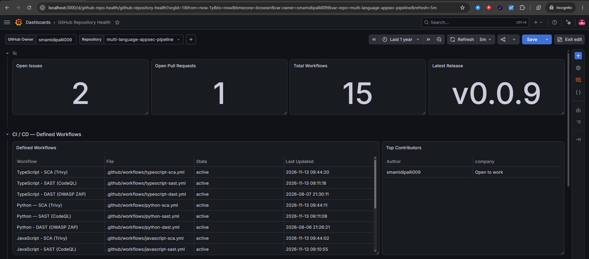

Shows Open Issues (2), Open Pull Requests (1), Total Workflows (15), Latest Release (v0.0.9), all 15 workflow files with their state and last-updated timestamp, and Top Contributors.

**Commits, Pull Requests and Issues**

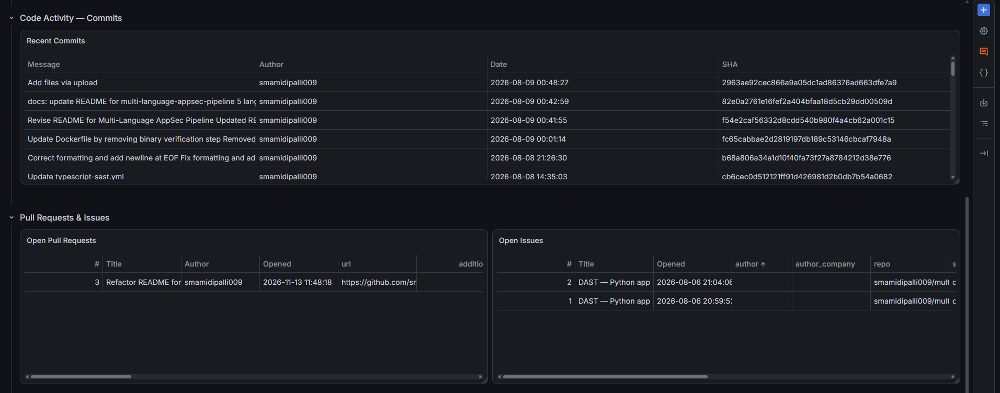

Recent Commits table with message, author, date, and full SHA. Open Pull Requests and Open Issues tables show live data pulled directly from the GitHub API.

### Setup

**1. Install the GitHub datasource plugin**

```bash
grafana-cli plugins install grafana-github-datasource
sudo systemctl restart grafana-server
```

**2. Add the datasource**

Grafana > Connections > Add new connection > GitHub > Add new data source.

Enter a GitHub Personal Access Token with these permissions: Actions, Contents, Issues, Metadata, Pull requests.

**3. Import the dashboard**

Grafana > Dashboards > Import > upload `grafana/dashboards/github-repo-health.json` > select your GitHub datasource > Import.

**4. Set the branch name**

In the Commits panel editor, set the branch field to your default branch (e.g. `main`) so commit history loads correctly.

---

## Way 2: Python Exporter + Prometheus + Grafana

**Best for:** DORA metrics, live active/queued job tracking, 30-day trend history, threshold alerting.

```
GitHub REST API → Python Exporter → Pushgateway → Prometheus → Grafana
```

The Python exporter polls the GitHub API on a configurable interval and pushes metrics to Prometheus Pushgateway. Grafana queries Prometheus with PromQL to show trends, thresholds, and history.

### What it shows

| Section | Panels |
|---|---|
| **DORA Metrics** | Deploy Frequency, Change Failure Rate, MTTR, Open Issues, Open PRs |
| **Active Runs (Live State)** | Currently Running, Queued, Active Runs by Workflow, Queued Runs by Workflow |
| **CI/CD Health** | Run Outcomes donut (30-day), Runs by Workflow and Outcome |
| **Workflow Duration** | Avg run time per workflow (successful runs) |
| **Workflow File Status** | Table of all workflow files and active/disabled state |

### Live Test Results

Tested against [smamidipalli009/multi-language-appsec-pipeline](https://github.com/smamidipalli009/multi-language-appsec-pipeline), a 15-workflow AppSec pipeline covering DAST (OWASP ZAP), SAST (CodeQL), and SCA (Trivy) across Go, Java, JavaScript, Python, and TypeScript.

#### Test 1: 1 running, 3 queued

**GitHub Actions (source of truth)**

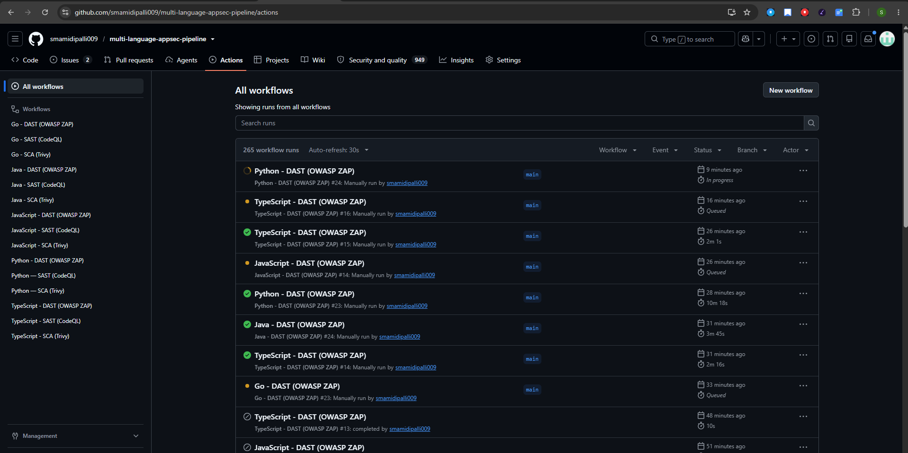

**Grafana Dashboard (real-time)**

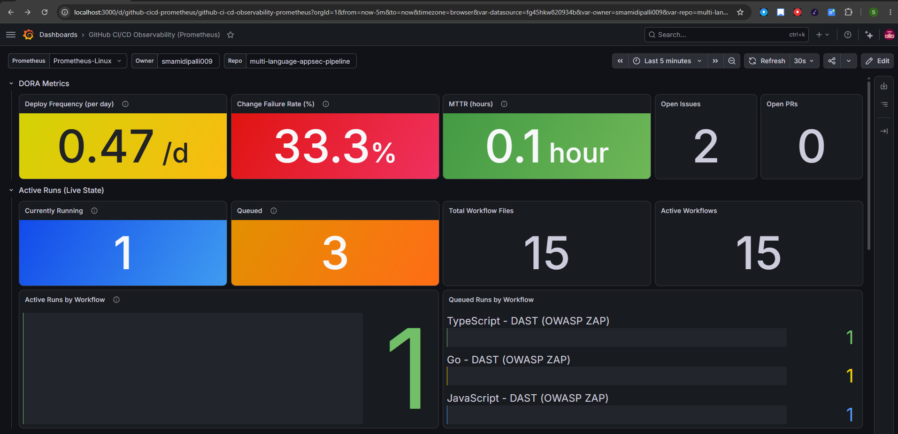

**What matched:**
- Currently Running: **1** (blue) ✓ matches Python DAST in_progress on GitHub
- Queued: **3** (orange) ✓ matches TypeScript, Go, JavaScript DAST queued on GitHub
- Queued Runs by Workflow bar gauge correctly lists all three workflow names with count 1 each
- DORA metrics reflect accumulated 30-day history: 0.47/d deploy frequency, 33.3% CFR, 0.1h MTTR

#### Test 2: 1 running, 2 queued

**GitHub Actions**

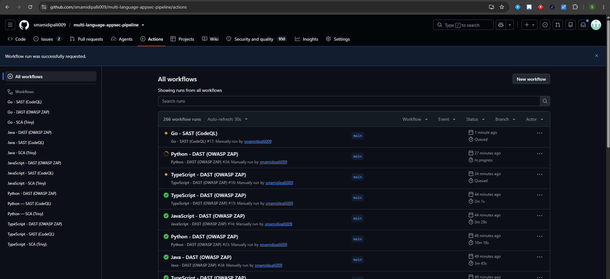

**Grafana Dashboard**

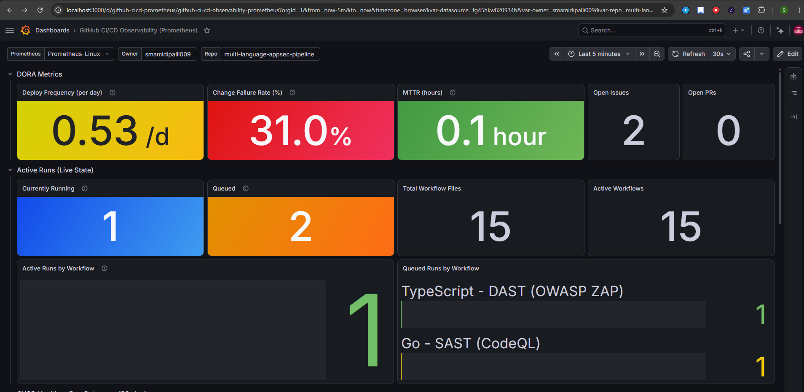

**What matched:**
- Currently Running: **1** ✓
- Queued: **2** ✓
- Queued Runs by Workflow: TypeScript DAST and Go SAST (CodeQL) ✓
- DORA: 0.53/d deploy frequency, 31.0% CFR, 0.1h MTTR

#### Test 3: All jobs complete (zero state)

**GitHub Actions: All complete**

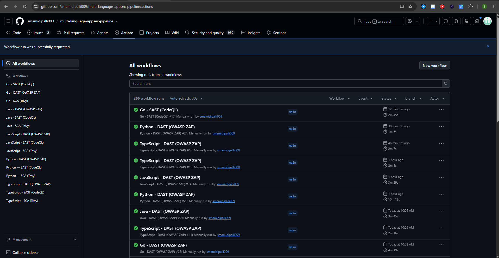

**Grafana Dashboard: Zero state**

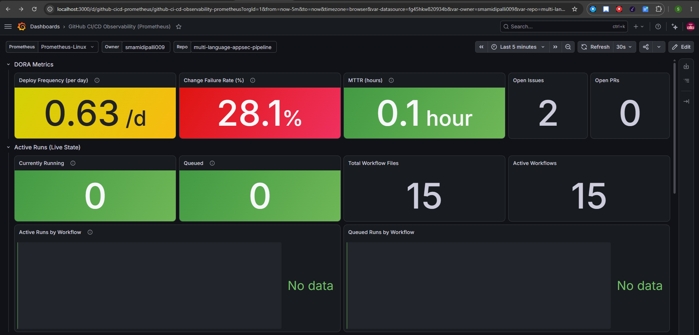

**What matched:**
- Currently Running: **0** (green) ✓ bar gauge shows "No data" (correct, no active runs to display)
- Queued: **0** (green) ✓
- DORA numbers updated: deploy frequency rose to 0.63/d as more successful runs accumulated

### Dashboard Sections Explained

#### CI/CD Health: Run Outcomes (30-day)

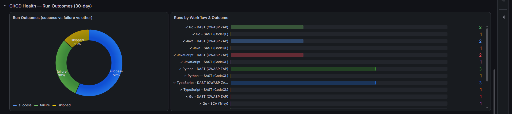

The donut breaks down all completed runs in the last 30 days: 57% success, 30% failure, 13% skipped. The bar chart on the right shows pass and fail counts per workflow, immediately answering "which workflow is the least reliable?"

#### Workflow Duration

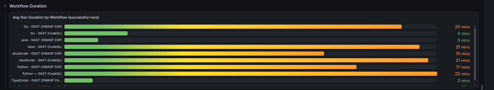

Average runtime per workflow across successful runs. Python SAST at 22 mins and Java SAST at 21 mins are the longest, prime candidates for GitHub Actions caching or runner size upgrades.

#### Workflow File Status

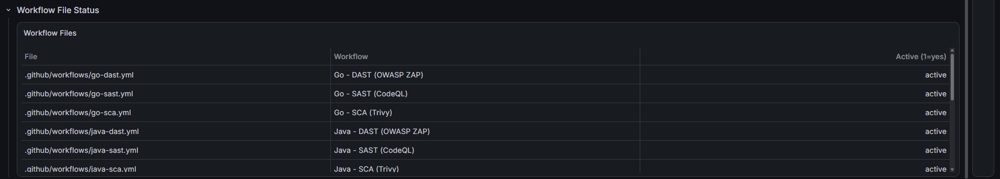

Table of all workflow files with active/disabled state. Useful for auditing silently disabled workflows.

### Setup

**1. Install dependencies**

```bash
cd exporter
python3 -m venv .venv
.venv/bin/pip install -r requirements.txt
```

**2. Create a GitHub Personal Access Token**

GitHub > Settings > Developer settings > Personal access tokens > Fine-grained tokens.

Required repository permissions (read-only): Actions, Issues, Metadata, Pull requests.

**3. Configure environment**

```bash
cp exporter/.env.example exporter/.env
# Edit .env and set GITHUB_TOKEN, GITHUB_OWNER, GITHUB_REPO
chmod 600 exporter/.env
```

**4. Start Pushgateway**

```bash
./pushgateway --web.listen-address=:9091
```

**5. Configure Prometheus**

Add to `prometheus.yml`:

```yaml
scrape_configs:
  - job_name: 'pushgateway'
    honor_labels: true
    static_configs:
      - targets: ['localhost:9091']
```

**6. Run the exporter**

```bash
cd exporter
set -a && source .env && set +a
.venv/bin/python3 github_exporter.py
```

**7. Import the dashboard**

Grafana > Dashboards > Import > upload `grafana/dashboards/github-cicd-prometheus.json` > select your Prometheus datasource > Import.

### Configuration

| Variable | Default | Description |
|---|---|---|
| `GITHUB_TOKEN` | required | GitHub Personal Access Token |
| `GITHUB_OWNER` | `smamidipalli009` | Repo owner or org |
| `GITHUB_REPO` | `multi-language-appsec-pipeline` | Repository name |
| `PUSHGATEWAY_URL` | `localhost:9091` | Pushgateway address |
| `POLL_INTERVAL` | `300` | Seconds between polls |
| `LOOKBACK_DAYS` | `30` | Days of history for DORA calculations |

---

## Reusing for any repository

Both dashboards have Owner and Repository dropdowns at the top. Change them to monitor any repo without touching the exporter or datasource configuration.
